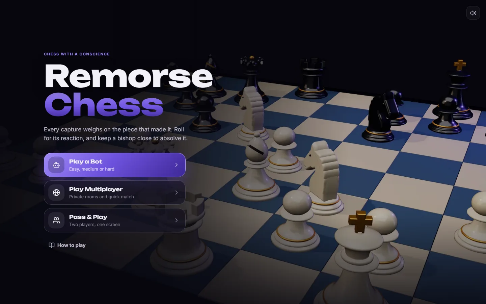
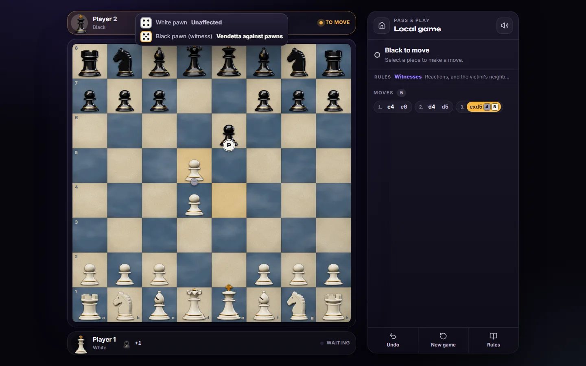
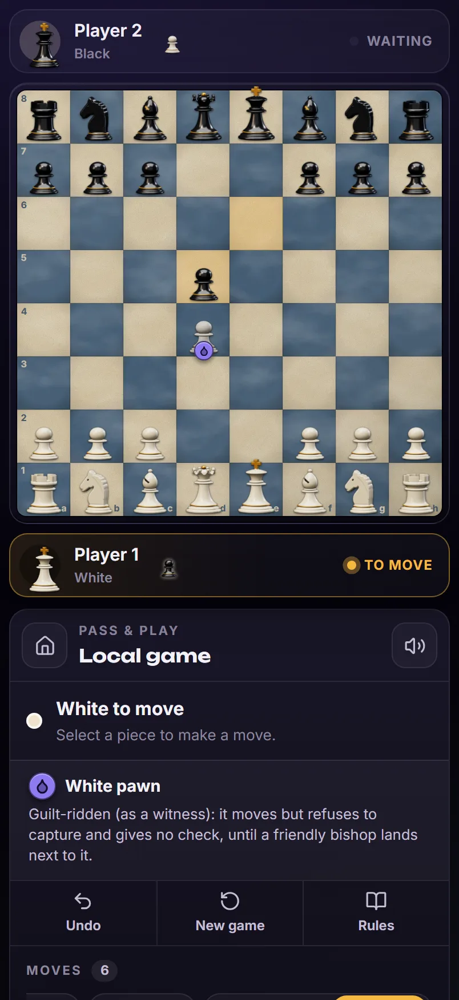
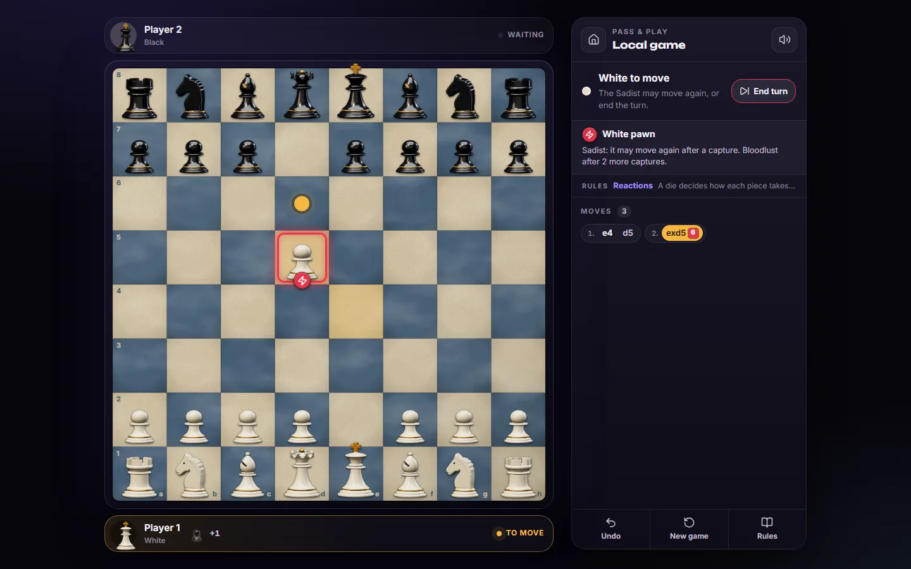

# Remorse Chess

Chess where the pieces have a conscience. Every capture weighs on the piece that made it: it may turn pacifist, freeze in despair, shrug it off, or get a taste for it. Bishops hear confessions. Play the bot, a friend on one screen, or an opponent online.

The variant is by **Bardelo Bardalini**, who published it in five YouTube Shorts in November 2026. This is an independent implementation of what he describes there.

**Status: complete, deployed and playable.** Nothing has been played on a real phone or by real opponents yet.

**Play it:** https://remorse-chess.vercel.app

The first online connection can take up to a minute: the multiplayer server runs on a free tier and sleeps when nobody is playing. Pass & Play and the bot work instantly and offline.



| A capture, the capturer's roll and a witness's vendetta | A guilt-ridden pawn, explained | A Sadist that may move again |
|---|---|---|
|  |  |  |

The screenshots are made by `node scripts/tour-screenshots.mjs http://localhost:4274 docs/screenshots`.

## The rules

It is standard chess, and you still win by checkmate. What changes is what a capture does to the piece that makes it.

The game offers three rule sets, each adding one layer of the creator's videos. Every rule below is labelled **creator's video** (he says it, and the video is linked) or **this app's interpretation** (he does not say, and this app had to decide).

Sources, all by the creator:

1. [Remorse Chess](https://www.youtube.com/shorts/H-JyKN_1jM4) (base rules)
2. [Remorse Chess: Psychos & Devastation](https://www.youtube.com/shorts/_ySYb2fEvRQ) (capture reactions)
3. [Remorse Chess: Announcement & Reclassification](https://www.youtube.com/shorts/mm3rmrhY_KM) (he withdraws the word in the previous title and renames that reaction **Sadist**; this app only uses the new name)
4. [Remorse Chess: Reactions to Attacks Pt. 1](https://www.youtube.com/shorts/DJ3hAbNY6vc) (witnesses)
5. [Remorse Chess: Reactions to Attack Pt. 2](https://www.youtube.com/shorts/UYv9RKw2zWI) (vendetta)

### Classic (video 1, no dice)

| Rule | Certainty |
|---|---|
| A piece that captures becomes **guilt-ridden**: a token goes under it. | creator's video 1 |
| A guilt-ridden piece is a pacifist: it moves as usual but refuses to capture. | creator's video 1 |
| Moving a bishop to a square adjacent to a guilt-ridden piece absolves it, and it can capture again. | creator's video 1 |
| A bishop that captures is guilt-ridden too, takes one turn to clean its own conscience, then absolves itself. | creator's video 1 |
| With no bishops left, a side cannot absolve until a pawn promotes to a bishop. | creator's video 1 |
| You win by checkmate. | creator's video 1 |

### Reactions (videos 1 to 3, the default)

| Rule | Certainty |
|---|---|
| The first time a piece captures, roll a D6. That is the piece's reaction for the whole game: each piece rolls once. | creator's video 2 |
| **1: Devastated.** The piece is immobilised. Absolve it with a bishop within three turns or it removes itself. | creator's video 2 |
| **2 or 3: Guilt-ridden**, as in Classic. | creator's video 2 |
| **4 or 5: Unaffected.** | creator's video 2 |
| **6: Sadist.** It gains an extra move after making a capture; no second extra move if that move captures too. | creator's videos 2 and 3 |
| A Sadist that has taken three pieces in total gains **bloodlust**: it only moves if it can take a piece, and it will take friendly pieces. | creator's video 2 |

### Witnesses (videos 1 to 5)

| Rule | Certainty |
|---|---|
| When a piece is taken, each piece of its own side adjacent to the capture rolls a D6. | creator's video 4 |
| **1 or 2:** the witness is temporarily guilt-ridden. A bishop clears it, and it does not count as the piece's capture reaction (it still rolls at its first capture). | creator's video 4 |
| A witness that was already guilt-ridden and rolls 1 or 2 is temporarily **devastated**, and needs a bishop within three turns. | creator's video 4 |
| **3 or 4:** no reaction. | creator's video 5 |
| **5 or 6: Vendetta.** One guilt-free attack, usable only against the piece type that made the capture. | creator's video 5 |
| A piece that is already a Sadist is never affected by a witness roll. | creator's video 4 |

### This app's interpretation

The videos leave these questions open. The answers are this app's, not the creator's. Each one is a named constant or small function in [`src/variant/interpretation.ts`](src/variant/interpretation.ts), so changing a ruling is a one-line edit.

| Question | This app's ruling | Certainty |
|---|---|---|
| What is "adjacent"? | All eight neighbouring squares, for absolution and for witnesses. | this app's interpretation |
| Which bishop absolves, and when? | A friendly bishop that is itself healthy. The moment its move lands, every afflicted friendly piece next to the landing square is cleared (guilt-ridden or devastated, temporary or not). A piece that walks up to a bishop is not absolved. | this app's interpretation |
| Does promoting to a bishop absolve? | Yes: the new bishop absolves the pieces next to its promotion square. | this app's interpretation |
| How does a bishop's "one turn" work? | A guilt-ridden bishop absolves itself when its owner has finished their next turn. A devastated bishop needs another bishop. | this app's interpretation |
| Is a reaction a one-off or a disposition? | A disposition: a piece that rolled guilt-ridden is guilt-ridden again after every capture, a piece that rolled devastated is devastated again, and an unaffected piece never suffers from its own captures. | this app's interpretation |
| Do afflicted pieces give check? | No. Guilt-ridden and devastated pieces give no check and control no squares, so a king may stand next to them and castle past them. | this app's interpretation |
| Whose turns are the "three turns"? | The owner's. If the piece is still devastated when the owner's fourth turn would start, it is removed before they move. | this app's interpretation |
| Do kings roll? | Yes, like any piece. A devastated king that is not absolved in time removes itself and its side loses. | this app's interpretation |
| The Sadist's extra move | Optional (there is an End turn button), made with the Sadist itself, any legal move for it. The capture that rolls the 6 already earns one. | this app's interpretation |
| Can a king be captured? | Never, by any move. A piece with bloodlust may take any friendly piece except its own king; friendly captures count toward its three. | this app's interpretation |
| Vendetta details | It can be used while guilt-ridden, rolls no reaction, causes no guilt and is used up. The victim's neighbours still roll. A new vendetta replaces an old one. A vendetta against the king (when a king made the capture) can never be collected. | this app's interpretation |
| Order of rolls | The capturer first, then witnesses in board order (a8 to h1). A witness that is already devastated still rolls. | this app's interpretation |
| Standard chess | En passant is a capture by the pawn; its witnesses are the neighbours of the captured pawn. Castling, promotion and the draws are standard. | this app's interpretation |
| When is the position judged? | Every roll and the Sadist's extra move happen before check, checkmate and stalemate are judged for the next player. A side with no legal move and no check is stalemated, even when that is because its pieces are immobilised or refuse to capture. | this app's interpretation |

One consequence worth knowing: because a guilt-ridden piece gives no check, a capture that would be checkmate in chess often is not. In Classic it never is.

### On the board

Each status has its own token under the piece, readable at phone size: a violet tear for guilt-ridden, an orange square with the 3-2-1 countdown for devastated, a small grey mark for unaffected, a red bolt for a Sadist, a flame for bloodlust, and a white token with the target's letter for a vendetta. Tapping any piece explains its status in words. Every die is shown as it is rolled, with the piece, the number and the outcome, and stays in the move list.

## Modes

- **Play a Bot:** Easy, Medium or Hard, as White or Black. Works offline.
- **Pass & Play:** two players on one screen, with undo.
- **Play Multiplayer:** a private room with a six-character code, or quick match (which only pairs players who chose the same rule set, and lets you play a bot while you wait). Reconnects, resignation, rematch and quick-message chat.

Every mode offers the three rule sets. The choice is remembered on the device, and an online room shows its rule set to the player who joins.

## How it works

- **Rules engine** ([`src/game.ts`](src/game.ts)): a complete standard-chess move generator in two layers (piece movement, then the check rules), with no chess library. Remorse Chess plugs into it in two places: one options object says who may move, capture and give check, and [`src/variant/remorse.ts`](src/variant/remorse.ts) resolves what a move does to the pieces' consciences. The same code runs in the browser, the bot and the server.
- **Dice:** the engine never makes its own randomness. `applyMove(state, moveId, rng)` takes the dice as an argument and records every roll in the move log. Online, only the server rolls (from the operating system's secure generator) and both players receive the result; a client sends a move and nothing else.
- **Bot** ([`src/bot.ts`](src/bot.ts)): alpha-beta search with iterative deepening and quiescence, in a web worker. It does not branch on dice. Inside the search every die shows 3, so an untested piece is assumed to come out guilt-ridden and witnesses are assumed not to react, while pieces whose reaction is already known behave exactly (a Sadist gets its extra move, a devastated piece counts down). The real dice are rolled when the move is played.
- **Online play** ([`server/game-server.ts`](server/game-server.ts)): an authoritative Node and Socket.IO server. Players get generated names; nobody can type text another player sees.
- **Look:** one dark theme from design tokens ([`src/theme/tokens.css`](src/theme/tokens.css)). The board, the twelve piece sprites, the home scene and the icon are rendered from 3D models by a scripted three.js studio ([`art/`](art/README.md)).
- **Mobile shell:** Capacitor projects in `ios/` and `android/` with a placeholder bundle ID. They have never been built.

[`docs/ARCHITECTURE.md`](docs/ARCHITECTURE.md) has the details.

## Run locally

```bash
npm ci
npm run dev:multiplayer   # web app on http://127.0.0.1:4274 and game server on :4275
npm test                  # every automated test
npm run build             # type-check and production build
```

`npm run dev:local` runs only the web app (Pass & Play and the bot do not need the server). The server's health check is `GET /health`.

For repeatable checks, a pass-and-play game can be opened directly with a rule set and its first dice scripted: `http://127.0.0.1:4274/local?rules=witnesses&dice=4,5,1`. This only affects games on that device.

## Verification

**Automated (`npm test`, 201 tests, all passing):**

- `tests/remorse.test.ts`, with scripted dice: each face of the capture die; that a reaction is rolled once and returns after later captures; that guilt-ridden and devastated pieces cannot capture and give no check (including castling past one); absolution by an arriving bishop, by a promotion to bishop, and not by a stationary bishop, a guilt-ridden bishop or an enemy bishop; the bishop's own one-turn penance; the no-bishop lockout; the devastation countdown and self-removal, including a king (which loses the game); the Sadist's extra move (optional, same piece, no stacking, move numbering); bloodlust (capture-only, friendly captures, never a king); every face of the witness die, doubling to devastated, vendetta typing, Sadist immunity, en passant witnesses; how Classic, Reactions and Witnesses differ; checkmate and stalemate under these rules.
- `tests/remorse-bot.test.ts`: 36 random games across the three rule sets checked for consistency after every move; the bot returns legal actions (including ending a turn), takes material with an extra move, saves a devastated king, beats a weaker level with real dice, and answers within 1.5 seconds.
- `tests/multiplayer.test.ts`, a real Socket.IO server with real clients: the server rolls the dice and both players receive identical rolls; a pending extra move keeps the turn and can be passed only by its owner; quick match only pairs equal rule sets; plus rooms, reconnects, resignation, rematch, draws and chat rules.
- `tests/perft.test.ts`, `tests/game.test.ts`, `tests/bot.test.ts`: the standard-chess tests of the base (move-generator node counts against published values, castling, en passant, promotion, draws, notation, bot tactics), run with the rule set switched off, so the underlying chess is still verified.

**Scripted browser checks (Playwright, at 1440x900 and 402x874, run against the local dev servers on 2026-11-19):**

- `node scripts/e2e-bots.mjs`: a whole game against the hard bot; the rule-set pickers; castling, check, mate, a draw and a promotion; and, with scripted dice, a roll shown and logged, guilt, absolution, relapse, a Sadist's extra move taken and declined, a witness's vendetta collected, a devastated pawn counting down 3-2-1 and removing itself; the rules dialog's sources, interpretation list and credit; a two-browser online game in which both players see the same server-rolled dice; quick match not pairing different rule sets. No console errors.
- `node scripts/tour-screenshots.mjs`: every screen at both sizes, with no console errors. The screenshots were looked at and the layout problems found were fixed.

**Never tested:** real phones or tablets; compiled iOS or Android builds; the sound effects by ear (they are synthesized in code and were never listened to); game balance and whether any rule set is fun over a full game with real players; bot strength against people; the deployed site and server (nothing is deployed yet).

## Known limitations

- **Balance is unknown.** The creator himself says in his fifth video that the full system is too complicated to keep track of over the board. Nobody has played these rule sets enough to know whether they are fair or fun.
- **The bot plans as if every die shows 3.** It follows every rule, but it does not weigh the chance of a 1 or a 6 before capturing, so it sometimes walks into a devastation a careful player would have feared. It is exact only in Classic.
- **Undo re-rolls.** In Pass & Play and bot games, undoing a capture and making it again rolls a new die. It is a casual-play convenience, not a fair-play feature. Online games have no undo.
- **Draws.** The fifty-move rule and repetition still apply, and repetition compares the pieces' consciences as well as their squares. A game where both sides are fully pacified and bishopless ends by the fifty-move rule.
- **Witness-heavy captures produce long roll cards** (up to nine lines), which cover the top of the board for a few seconds.
- **The online server keeps games in memory.** A server restart ends running games.
- **The mobile projects are unbuilt**, and the app ID is a placeholder.

## Story

This is the third Foundry game built on the Knight Checkers shell (the board UI, room server, bot framework and rendering pipeline), after Knight Checkers itself and the standard-chess base this repository started from. It was made overnight on 2026-11-19/20: the rules were gathered from the creator's five Shorts, the open questions were listed and decided, and the game was built and checked in one unattended session.

## AI assistance and Zach's role

Zach Shirley chose the variant and commissioned the build. Claude (Anthropic's AI model) researched the rules from the creator's videos, made the interpretations listed above, and wrote the code, the tests and the rendered art in an unattended session. Zach had not reviewed or played this version when it was committed.

## Attribution

- **The variant, Remorse Chess, is by Bardelo Bardalini** ([YouTube](https://www.youtube.com/@bardelo_bardalini), [Instagram](https://www.instagram.com/bardelo_bardalini/)). The five source videos are linked under "The rules". This project is not affiliated with or endorsed by him.
- All code and art in this repository are original to it. No rules or code were taken from other implementations of the variant.
- Fonts: [Unbounded](https://github.com/w3f/unbounded) and [Inter](https://github.com/rsms/inter), both under the SIL Open Font License.
- Icons: [Lucide](https://lucide.dev), ISC License.
- The piece-square tables in the bot follow Tomasz Michniewski's published "simplified evaluation function".

## License

No license has been chosen yet. **All rights reserved; the source is public to read.**
